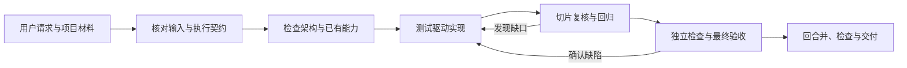

# 编码助手 Skill

将明确的编码任务转为符合有效要求和项目架构的实现。它以测试驱动开发为核心，先核对输入、复用能力与现有边界，再完成最小实现、相关回归和交付证据；适用于功能开发、缺陷修复、重构和中断后的继续开发。

技能入口为 [SKILL.md](SKILL.md)。技能包自包含，不依赖其他技能、固定任务系统或特定文档模板，也不绑定技术栈、分层方式、测试框架或覆盖率阈值。

## 工作方式



主 agent 保留完整目标、核心 TDD、接口取舍、整合和最终完成判断。子 agent 只在确有独立上下文或明确分工收益时加入：

| 角色 | 使用时机 | 主要结果 |
|---|---|---|
| [勘察](references/agents/勘察.md) | 代码陌生、调用链复杂或影响范围不清 | 带位置的架构、复用和测试入口发现 |
| [独立验证](references/agents/独立验证.md) | 实质行为变更或复杂改动需要新视角 | 基于原始要求和当前差异的缺陷判断与验收 |
| [实现（可选）](references/agents/实现.md) | 同一任务中存在接口清楚、修改范围可分开的独立行为切片 | 完成所分配切片的测试、实现和回归 |

委派使用宿主已有能力；工具不支持时由主 agent 完成，并如实标明独立性限制。

## 适用场景

- 根据现有接口、代码和验收要求实现一个新功能。
- 先用回归测试复现缺陷，再定位并修复问题。
- 在保持行为的前提下整理重复逻辑、职责边界或模块结构。
- 在需求、工作区和交接记录已存在时恢复未完成的编码任务。
- 对最终差异执行自动检查、独立审查、相关回归与交付核对。

只要求计划、讨论影响或独立评审时，交付所请求的结果，不因调用本技能自动修改代码。纯需求探索、项目设计、代码讲解和技能维护不自动进入编码流程。

## 使用

技能已被宿主发现时，在目标项目中使用：

```text
$coder-assistant 按这个任务和现有架构实现功能，先写测试，优先复用已有能力。
```

也可以直接限定范围：

```text
用 $coder-assistant 修复这个问题，先建立能复现缺陷的测试，并验证相关回归。
```

```text
继续上次开发，先核对有效需求、工作区变化和最后测试，再从未完成的行为切片继续。
```

```text
只审查当前改动是否符合任务、架构和复用约束，本轮不要修改代码。
```

需要限制范围时，直接写清完成条件、必须兼容的接口、不能改动的边界和希望执行的验证。任务或规则不足时，技能会先查相关材料并补足影响当前实现的关键缺口，不要求先生成完整设计文档。

## 执行闭环

1. **核对输入与现状。** 读取仓库指令、用户指定材料和直接相关代码，区分目标、约束、现状与假设；先确认任务专属 worktree 和既有修改，再运行适用测试基线。
2. **界定本次实现。** 明确结果、范围、验收、依赖和验证方式，拆成可验收的最小行为切片。
3. **检查架构和复用。** 定位责任、依赖方向和已有能力，选择直接复用、扩展、组合、提取或新建；重要选择保留可定位依据。
4. **测试驱动实现。** 先运行能证明目标行为缺失的测试，再做满足约束的最小实现，必要时重构并回归。
5. **按切片复核。** 检查真实差异、范围偏移、重复实现、接口兼容和测试证据；需求变化时停止受影响旧方案并调整。
6. **验证、回合并和交付。** 核对最终差异与验收覆盖，完成本地提交、rebase 到最新目标、验证及目标快进更新，分别报告实现、实际验证、回合并状态、阻塞和剩余风险。

自动检查、独立代码审查、运行验收及项目规定的人审分别判断。某一项通过不能替代其他必要项，旧提交或修复前的通过结果也不能冒充当前状态。

## 持续开发

任务工作区、输入基线及已有修改按[工作区与输入](references/shared/工作区与输入.md)核实；追问、调整和中断恢复复用原任务工作区。

任务完成后默认由主 agent 执行本地提交、rebase 到最新目标、验证和目标快进更新，见[自动回合并](references/workflows/回合并.md)。

持续开发优先复用项目已有的任务、文档和交接位置。与 `project-design` 共用项目根目录的英文隐藏文件 `.project-context.json`，仅保存项目、文档、任务、原型源及设计／开发交接入口，按 [JSON 模板](assets/项目上下文模板.json) 补本次必需项；字段与双向交接见 [项目上下文](references/shared/project-context.md)。需要保存时，可使用[开发交接模板](assets/开发交接模板.md)，只记录当前目标、改动、最后实际测试、架构和复用决定、阻塞及下一步。业务材料写入目标项目，不写入技能包。

## 安装与更新

仓库：[FarmerLi/coder-assistant-skill](https://github.com/FarmerLi/coder-assistant-skill)。技能名称和默认安装目录名均为 `coder-assistant`。

在目标项目中把下面的提示词交给 Agent：

```text
请读取 https://github.com/FarmerLi/coder-assistant-skill 仓库中的《安装与更新.md》，将 coder-assistant 安装到当前项目；已有安装则更新到最新可用版本。优先使用最新正式 Release；若仓库尚无正式 Release，则使用默认分支 main 的最新提交，并明确标为开发版。请完成版本检查、完整包下载、必要的备份替换和安装校验，并报告版本、提交与安装位置。
```

默认安装到目标项目 `.agents/skills/coder-assistant/`，不修改项目 `AGENTS.md`。个人全局、固定 Tag、指定分支或严格完整性检查按实际请求选择。完整流程见[安装与更新](安装与更新.md)。

## 技能包结构

| 位置 | 职责 |
|---|---|
| [SKILL.md](SKILL.md) | 用途、入口、执行流程、共同约束与按需路由 |
| `references/agents/` | 勘察、独立验证和实现切片的委派职责 |
| `references/shared/` | 输入、执行契约、项目上下文、子代理协作及工作区规则 |
| `references/workflows/` | 架构、复用、TDD、验证、审查和自动检查方法 |
| `assets/` | 可选交接模板与自动检查配置示例 |
| `scripts/` | 包内引用检查和可选的自动检查执行器 |
| `tests/` | 行为判据、隔离夹具和验证记录，不作为安装运行依赖 |

公共规则在对应参考文件中维护，入口只保留概要与路由。不要将后续修复逐条叠加到 `SKILL.md`，也不要复制同一规则到多个文件。

## 维护与验证

维护改动至少检查技能格式、入口元数据、Markdown 引用及受影响行为：

```sh
python3 scripts/check_links.py .
python3 -m unittest discover -s tests -p 'test_*.py' -v
```

进一步验证自动检查执行器、样例项目和技能行为：

```sh
python3 -m unittest discover -s tests -p 'test_review_checks.py' -v
python3 -m unittest discover -s tests/fixtures/order_project/tests -v
```

可运行检查与模型行为验证分别记录。脚本检查通过只证明其支持的引用或确定性行为，不代表宿主已发现技能、自动选择正确，也不代表独立审查或真实项目验收已完成。场景与证据边界见[行为验证](tests/行为验证.md)。
